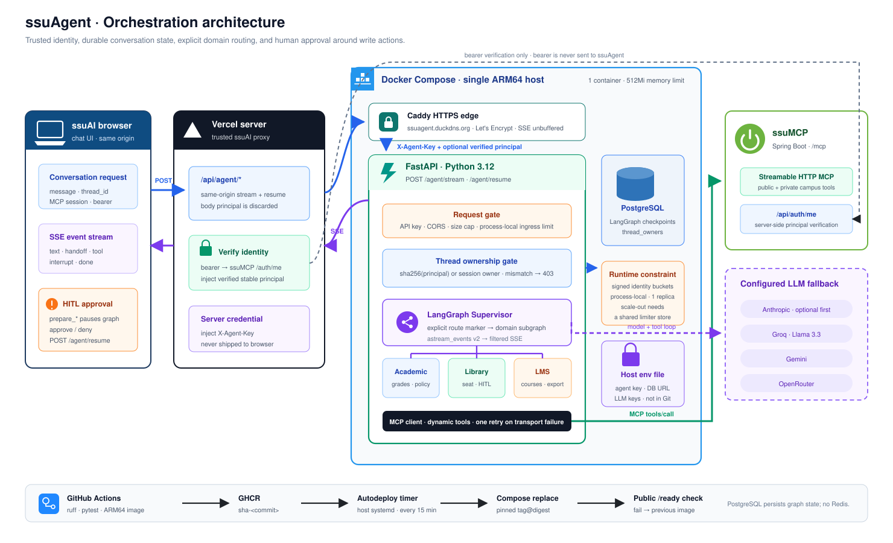

# ssuAgent

[](https://github.com/ghdtjdwn/ssuAgent/actions/workflows/ci.yml)
[](https://github.com/ghdtjdwn/ssuAgent/actions/workflows/security.yml)
[](https://github.com/ghdtjdwn/ssuAgent/actions/workflows/codeql.yml)

[한국어](README.md) · **English**

A FastAPI/LangGraph orchestration service that routes ssuAI requests to domain-specific MCP tools
and manages conversation state, SSE streams, and user-approval flows.

[Live chat](https://ssuai.vercel.app/chat) ·
[Documentation map](docs/README.md)

## Role in the platform

| Service | Responsibility | Repository |
| --- | --- | --- |
| ssuAI | User interface, same-origin BFF, authentication state, and SSE/HITL UX | [ghdtjdwn/ssuAI](https://github.com/ghdtjdwn/ssuAI) |
| **ssuAgent** | **Intent routing, tool composition, conversation checkpoints, and HITL orchestration** | This repository |
| ssuMCP | Campus domain logic, MCP/REST contracts, authentication, and state changes | [ghdtjdwn/ssuMCP](https://github.com/ghdtjdwn/ssuMCP) |
| ssu-ai-service | Isolated embedding-request gateway | [ghdtjdwn/ssu-ai-service](https://github.com/ghdtjdwn/ssu-ai-service) |

This service never calls university systems directly. It consumes domain capabilities only through
MCP. The ssuAI BFF verifies browser authentication and forwards only the minimum principal and MCP
session context.

## Architecture



```text
browser
  → ssuAI same-origin agent proxy
  → FastAPI stream/resume boundary
  → LangGraph supervisor
  → academic · library · LMS specialist
  → ssuMCP tools over Streamable HTTP
```

- The supervisor routes the current user turn to a domain specialist; each specialist loads only
  the MCP tools it needs.
- A LangGraph PostgreSQL checkpointer persists conversations and interrupts. The verified principal
  hash is bound to `thread_id`, preventing another user from reading, resuming, or deleting it. The
  live MCP bearer capability stays in request context and is not checkpointed.
- Library writes interrupt after `prepare_*` and resume with `confirm_action` only after explicit
  approval in ssuAI.
- Only configured providers join the Anthropic → Groq → Gemini → OpenRouter sequence. Each agent's
  manual `bind_tools` loop controls provider-specific tool-call differences and fallback. Groq uses
  `ChatGroq` instead of the generic `ChatOpenAI` wrapper for tool-call content compatibility.
  Pricing, model availability, and organization quotas are external runtime constraints; this order
  does not claim a cost or accuracy advantage.

See the [architecture document](docs/architecture.md) for request, trust, and state boundaries and
the current single-replica constraint.

## What flows through the stream

`/agent/stream` is SSE: a sequence of `data: {json}` lines. A request that needs approval, such as a
library seat reservation, pauses the stream at `interrupt`; ssuAI sends the user's decision to
`/agent/resume` and the conversation continues on the same `thread_id`. The event names and order
below are the contract fixed by the [stream contract tests](tests/test_stream_interrupt.py).

```text
POST /agent/stream   {"message": "B-007 예약해줘", "thread_id": "…", "library_connected": true}
  data: {"type": "handoff",   "agent": "library", …}
  data: {"type": "interrupt", "data": {"action_id": 314, …}}
  (stream ends without done — waiting for the user's decision)

POST /agent/resume   {"thread_id": "…", "approved": true, "action_id": 314}
  data: {"type": "text",      "content": "…"}
  data: {"type": "done"}
```

- The resume stream emits no fresh `handoff` and no second `interrupt`; it ends with `done`.
- Denial (`approved: false`) never calls `confirm_action`; it streams a cancellation `text` and `done`.
- If graph execution fails, a fixed `error` event is sent instead of the exception text.

## Engineering evidence

| Problem | Implementation and verification |
| --- | --- |
| Another user resuming an existing conversation | Stable principal hash and thread-owner binding — [ADR 0010](docs/adr/0010-agent-thread-ownership-binding.md) · [security tests](tests/test_main_security.py) |
| Long-lived checkpoints retaining capabilities or personal data | Request-scoped capabilities, ownership-checked deletion, and bounded 30-day retention — [ADR 0023](docs/adr/0023-conversation-lifecycle-and-edge-identity.md) |
| Proxy egress sharing a single rate-limit bucket | Verified BFF-signed principal/IP pseudonym selects a per-user bucket — [edge tests](tests/test_main_security.py) |
| Broken resume semantics after stream reconnect or interrupt | Stable thread and explicit `resume` event ordering — [stream contract tests](tests/test_stream_interrupt.py) |
| A clear LMS export timing out in another LLM turn | Conservative direct routing and deterministic link generation — [ADR 0022](docs/adr/0022-deterministic-lms-export-download.md) · [LMS tests](tests/test_lms_agent.py) |
| Provider-specific tool-call formats and cascading failures | Configuration-driven provider sequence and agent-local fallback — [factory tests](tests/test_llm_factory.py) · [ADR 0004](docs/adr/0004-multi-provider-llm-fallback.md) |
| Handoffs duplicating answers or choosing the wrong tool | Routing and safety evaluation sets — [routing eval](tests/test_eval_routing.py) · [safety eval](tests/test_eval_safety.py) |
| Deployment of an unverified image | ARM64 image publication follows Ruff, formatting, and pytest; pull requests also run `import ssu_agent.main` inside the built image — [CI workflow](.github/workflows/ci.yml) · [deployment guide](docs/deploy.md) |
| Static security regressions and stale dependencies | CodeQL v4 Python analysis plus uv and GitHub Actions Dependabot — [CodeQL](.github/workflows/codeql.yml) · [Dependabot](.github/dependabot.yml) |

The main stack is Python 3.12, FastAPI, LangGraph, LangChain, PostgreSQL checkpointer, MCP
Streamable HTTP, SSE, uv, Ruff, pytest, Docker, and Docker Compose.

## Local development and verification

PostgreSQL and at least one LLM provider key are required. Keep real values in `.env` and never
commit them.

```bash
git clone https://github.com/ghdtjdwn/ssuAgent.git
cd ssuAgent
cp .env.example .env
set -a && source .env && set +a

uv sync --extra dev
uv run uvicorn ssu_agent.main:app --host 0.0.0.0 --port 8000
```

```bash
uv run ruff check .
uv run ruff format --check .
uv run pytest
uv run pytest tests/test_eval_routing.py
```

See the [configuration guide](docs/configuration.md) for each variable's security meaning and the
difference between local and production settings.

The versioned routing corpus contains nine prompts: six domain handoffs and
three direct answers, classified against four failure types. The test uses a fake chat model while
executing the real routing tools, markers, parser, and graph destinations after tool selection. It
is not a live-model tool-selection accuracy result. See [`evals/README.md`](evals/README.md) for the
evidence boundary.

## Deployment and operations

Production is a Docker Compose service on a single ARM64 VM. It moved off k3s + ArgoCD on 2026-10-15;
the reasons and trade-offs are in [ADR 0024](docs/adr/0024-single-vm-compose-timer-deploy.md) (Korean).

```text
main merge → CI (Ruff, pytest) → ARM64 image → ghcr.io/ghdtjdwn/ssuagent:sha-<commit>
  → host timer (every 15 min) detects the new sha tag → digest-pinned pull → compose up -d --wait
  → public /ready returns 200 → on failure, revert to the previous image
```

- The host holds no GitHub or registry credentials and pulls public images only. The Compose
  definition and env live in a private infrastructure repository.
- `GET /health` → `{"status":"UP","version":"0.2.0","build_sha":"<commit>"}`: process liveness plus the
  running commit. `GET /ready`: bounded PostgreSQL pool and checkpointer probe (the success criterion of
  the automatic rollout). `GET /healthz/deep`: upstream MCP diagnostics.
- The [deployment guide](docs/deploy.md) (Korean) lists what to check when a deploy did not land.

## Documentation

- [Documentation map](docs/README.md)
- [Architecture and trust boundaries](docs/architecture.md) (Korean)
- [Configuration and environment variables](docs/configuration.md) (Korean)
- [Docker Compose deployment and operational verification](docs/deploy.md) (Korean)
- [Operational incident records](docs/troubleshooting.md) (Korean)
- [ADR index](docs/adr/README.md) (Korean)

## Scope and limitations

- This is an unofficial project operated alongside the ssuAI suite; university data is handled only
  through ssuMCP.
- Production currently runs one replica and inbound rate limiting is process-local. Signed client
  identities provide correct per-user buckets within that process; scale-out still needs a shared store.
- CI stream/HITL unit tests use `MemorySaver`; the current gate does not include a container-backed
  restart-and-resume test against real PostgreSQL.
- The service depends on LLM providers and university systems. On tool failure, it reports the
  limitation or required connection instead of guessing.
- Production `/agent/*` endpoints require a server-to-server API key. Public users access them
  through ssuAI.

## License

[MIT](LICENSE)
