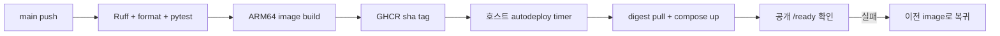

# ssuAgent 배포와 운영 검증

이 문서는 현재 production 배포 경로와 검증 기준을 설명한다. 요청·신뢰·상태 경계는
[architecture.md](architecture.md), 환경 변수는 [configuration.md](configuration.md)가 기준이다.

production은 2026-10-15에 k3s + ArgoCD에서 단일 ARM64 호스트의 Docker Compose로 옮겨졌다. 이 저장소의
`deploy/charts/ssu-agent/`와 `deploy/argocd/application-ssu-agent.yaml`은 이전 경로의 manifest이며 더 이상
production의 desired state가 아니다. 이전 경로와 그 운영 기록은
[이전 경로: k3s와 ArgoCD](#이전-경로-k3s와-argocd-2026-07--2026-10)에 남긴다.

## 배포 계약

1. `.github/workflows/ci.yml`이 Ruff, format check와 pytest를 실행한다. pull request에서는 빌드한 ARM64
   image 안에서 `import ssu_agent.main` smoke도 실행한다.
2. 검증이 성공한 `main` SHA만 `ghcr.io/ghdtjdwn/ssuagent:sha-<full-sha>` ARM64 image로 publish된다.
3. production 호스트의 systemd timer가 15분마다 자동 반영 스크립트를 실행한다. 스크립트는 공개 GitHub
   API로 `main`의 최근 commit을 읽고, 가장 최근 commit부터 GHCR에 `sha-<commit>` tag가 있는지 확인한 뒤,
   그 tag의 digest가 현재 고정된 digest와 다를 때만 pull한다.
4. 새 image를 `tag@digest`로 고정하고 `docker compose up -d --no-deps --wait`로 `ssu-agent` service만
   교체한다. 공개 주소의 `/ready`가 200을 반환해야 성공으로 기록한다.
5. 확인에 실패하면 이전 image로 되돌리고 다시 확인한다. 결과는 호스트의 배포 이력 로그에 남고, 실패로
   되돌린 digest는 다음 주기에 다시 시도하지 않는다.

자동 반영 스크립트와 Compose 정의는 production 호스트에 있으며 이 저장소에 포함되지 않는다. 호스트에는
registry나 GitHub 자격증명을 두지 않고 공개 package와 공개 저장소만 읽는다. image publish 성공은 배포
완료를 뜻하지 않으므로 배포 이력, 실행 중인 container의 image digest, health를 함께 확인해야 한다.

## Source of truth

| 대상 | 기준 파일 또는 상태 |
| --- | --- |
| CI와 image gate | `.github/workflows/ci.yml` |
| 실행할 image | production 호스트 Compose env의 `tag@digest` 고정값(이 저장소 밖, 자동 반영이 관리) |
| container 실행 조건 | Compose service 정의(이 저장소 밖). image와 같은 uid 1001로 실행한다 |
| Secret 값 | production 호스트의 env file(이 저장소 밖). 값은 Git에 두지 않는다 |
| 실제 배포 결과 | 배포 이력 로그, running container image digest, health endpoints |
| 이전 k3s 경로 manifest | `deploy/charts/ssu-agent/`, `deploy/argocd/application-ssu-agent.yaml` |

## Runtime 경계

- production target은 단일 ARM64 호스트의 Docker Compose다. edge는 Caddy reverse proxy이며 SSE 응답을
  버퍼링하지 않는다.
- LangGraph checkpoint와 thread owner는 같은 호스트의 PostgreSQL에 저장한다. container filesystem은 대화
  상태의 source of truth가 아니다.
- 새 image는 readiness 전에 legacy `mcp_session_id` checkpoint channel을 bounded batch로 치환하고
  checkpoint lifecycle trigger를 설치한다. 기본 100,000-row 안전 상한을 넘으면 startup이 실패하므로
  반영 전에 실제 legacy row 수를 확인하거나 `AGENT_CAPABILITY_SCRUB_MAX_ROWS`를 계획적으로 높인다.
  scrub과 retention/delete는 owner → checkpoint lock order를 공유하므로 교체 중 cleanup과 경합해도
  교착 없이 한쪽이 owner lock에서 대기한다.
- agent env file은 최소 `DATABASE_URL`, `AGENT_API_KEY`, 한 개 이상의 LLM provider key를 포함한다.
- production은 `AGENT_API_KEY_REQUIRED=true`와 실제 frontend origin allow-list를 사용한다. 공개 주소에서
  key 없는 `/agent/stream`은 401, allow-list 밖 origin의 preflight는 400이다.
- liveness는 shallow `/health`, readiness는 PostgreSQL pool과 checkpointer table을 bounded query로 확인하는
  `/ready`, upstream MCP 진단은 `/healthz/deep`을 사용한다. 자동 반영의 성공 판정은 `/ready`다.

Secret key 이름과 선택 provider는 [configuration.md](configuration.md)와 이전 경로의
[`secret.example.yaml`](../deploy/charts/ssu-agent/templates/secret.example.yaml)을 참고한다. 실제 값을
명령 기록, CI log, issue나 문서에 붙여 넣지 않는다.

## Release 검증

다음 순서로 같은 commit SHA를 끝까지 추적한다.

1. `main` CI의 test job 성공
2. 같은 SHA의 ARM64 image build/push 성공
3. 호스트 배포 이력 로그에 해당 SHA와 digest로 `success`가 기록됐는지 확인
4. `docker compose ps`로 container가 `healthy`인지, `docker inspect`로 running image가 기대한 `tag@digest`인지
   확인
5. `/health`가 `UP`, `/ready`가 `postgres=UP`, `checkpointer=UP`, `/healthz/deep`이 `mcp=UP`인지 확인
6. direct no-key `/agent/stream`이 401이고, ssuAI server proxy 경로가 계약에 맞는 상태 코드를
   반환하는지 확인
7. container log의 `legacy checkpoint capability scrubbed N row(s)`를 확인하고 재기동 후 같은 log가
   다시 나오지 않는지(idempotent 0건) 확인

Secret을 회전할 때는 env file 값을 바꾼 뒤 해당 service를 다시 만든다. env file 값은 실행 중인 process에
반영되지 않는다.

rollback한 이전 image도 additive trigger가 exact legacy capability channel을 DB 저장 전에 `None`으로
정규화하고 삭제 fence를 유지한다. hardened image를 다시 반영하면 startup scrub을 idempotent하게 다시
통과한다. scrub 상한 실패는 DB row를 일부 치환한 상태여도 안전하게 재실행할 수 있으므로 상한만 올려
반영을 재시도한다.

문서-only 변경은 CI의 `paths-ignore` 대상이므로 새 image가 생기지 않는다. 자동 반영은 tag가 없는 commit을
건너뛰고 가장 최근에 image가 있는 commit을 유지하므로 교체도 일어나지 않는 것이 정상이다.

### 2026-11-09 v0.2.0 반영 증거

[v0.2.0](https://github.com/ghdtjdwn/ssuAgent/releases/tag/v0.2.0)의 애플리케이션 코드는 `10deb12`다.
main CI [42599074409](https://github.com/ghdtjdwn/ssuAgent/actions/runs/42599074409)가
`ghcr.io/ghdtjdwn/ssuagent:sha-10deb12100b5b945f49704e2562b287453f21505`를 publish한 뒤 호스트에서
다음을 확인했다.

| 점검 | 관찰 결과 |
| --- | --- |
| 배포 이력 로그 | 10:16Z `success`, 이전 image `sha-4d0f39d…` → `sha-10deb12…@sha256:46d4052c…` |
| running container | image `sha-10deb12…@sha256:46d4052c…`, `healthy`, uid 1001, `mcp` 1.30.0 |
| `GET /health` | HTTP 200, `status=UP` |
| `GET /ready` | HTTP 200, `postgres=UP`, `checkpointer=UP` |
| `GET /healthz/deep` | HTTP 200, `mcp=UP` |
| key 없는 `POST /agent/stream` | HTTP 401 |

## Rollback

정상 rollback은 호스트의 image 고정값을 마지막으로 검증된 `tag@digest`로 되돌리고 `docker compose up -d
--no-deps --wait`로 service를 교체하는 작업이다. 자동 반영은 `/ready` 확인에 실패하면 같은 방식으로 스스로
복귀한다. 수동 rollback을 유지하려면 자동 반영을 먼저 끄고(스크립트의 비활성화 스위치), 원인을 고친 뒤 다시
켠다. 그렇지 않으면 다음 주기에 같은 image를 다시 올린다.

## 현재 운영 제약

- replica는 1개다. signed client identity는 process 내부 사용자 bucket을 정확히 나누지만 process-local
  counter 때문에 무검증 scale-out은 전역 quota를 보장하지 못한다.
- PostgreSQL checkpointer는 container 재시작 후 대화를 보존하지만, schema/setup과 connection pool 상태도
  readiness와 별도로 확인해야 한다.
- `/health`는 process liveness, `/ready`는 PostgreSQL/checkpointer traffic readiness다. `/healthz/deep`은
  MCP 진단이며 반영 성공 판정에는 포함하지 않아 upstream 장애가 agent 재시작이나 rollback으로 번지지 않는다.
- 배포 스크립트, Compose 정의, Secret, Vercel proxy wiring은 repository CI가 검증하지 못한다.

## 이전 경로: k3s와 ArgoCD (2026-07 ~ 2026-10)

2026-10-15 이전 production은 ARM64 k3s의 `ssuai-prod` namespace였다. ArgoCD Image Updater가 새 SHA tag를
감지해 `deploy/charts/ssu-agent/values.yaml`의 `image.tag`를 Git에 write-back하고, ArgoCD가 Helm chart를
auto-sync했다. 마지막 write-back은 2026-10-08 commit `ea49362`(`sha-1b9b4e29…`)이며 이 tag는 cluster에서
Pending으로 남아 실행된 적이 없다. 이관 뒤 `values.yaml`의 `image.tag`는 갱신하지 않으며, chart는 CI의
Helm lint와 Pod token mount 검증을 계속 통과하는 참고 manifest로 남긴다.

### 2026-07-18 릴리스 증거

라우팅 평가 계약을 추가한 pull request
[#65](https://github.com/ghdtjdwn/ssuAgent/pull/65)는 main commit
`b1f88e339f6ae081d9580d271747404cfe989721`로 머지됐다. 같은 commit에 대한
[main CI](https://github.com/ghdtjdwn/ssuAgent/actions/runs/29646212353)에서 다음 게이트가
실제로 완료됐다.

- Ruff check와 format check 통과
- pytest 306개 통과
- ARM64 image `ghcr.io/ghdtjdwn/ssuagent:sha-b1f88e339f6ae081d9580d271747404cfe989721`
  build·push 성공
- 별도 [gitleaks check](https://github.com/ghdtjdwn/ssuAgent/actions/runs/29646212349) 통과

ArgoCD Image Updater는 commit `e40fa68e98658d2b87430f35b7202e8a054f6c2a`로
`values.yaml`의 기대 image tag를 `sha-b1f88e339f6ae081d9580d271747404cfe989721`로
write-back했다. 그 후 공개 endpoint의 읽기 전용 probe는 다음과 같았다.

| 점검 | 관찰 결과 |
| --- | --- |
| `GET https://ssuagent.duckdns.org/health` | HTTP 200, `status=UP` |
| `GET https://ssuagent.duckdns.org/healthz/deep` | HTTP 200, `status=UP`, `mcp=UP` |

`/ready`와 retention/identity 계약은 이 증거 이후 추가됐으므로 위 표에 소급해 성공으로 기록하지 않는다.
당시 ArgoCD와 cluster 관리면은 직접 조회하지 못해 Application의 `Synced/Healthy`, Deployment rollout,
pod `Ready`·restart 수, 실제 running container image SHA는 확인하지 못했다. public health와 Git write-back만으로는
응답한 pod가 해당 SHA를 실행 중임을 증명할 수 없다는 한계가 이 경로의 검증 순서에 그대로 반영돼 있었다.

### 운영 사례: ArgoCD Application drift

#### 상황과 영향

2026-07-15, commit `498ddb0`의 CI와 ARM64 image publish는 성공했지만 production은 이전 image를 계속
실행했다. ArgoCD는 `Synced/Healthy`였기 때문에 표면 상태만 보면 정상 배포처럼 보였다. 기존 Ready pod가
계속 serving해 외부 중단은 없었지만, 새 코드가 배포되지 않은 상태였다.

#### 증거와 원인

- Git의 Application manifest는 현재 owner `ghdtjdwn`의 repository와 GHCR image를 가리켰다.
- cluster에 남은 live Application은 이전 owner의 repository와 image-list annotation을 유지했다.
- Image Updater log는 해당 image를 반복해서 `skipped` 처리했고 `values.yaml` write-back이 없었다.
- 따라서 `Synced/Healthy`는 stale source와 일치한다는 뜻이었을 뿐, 기대한 SHA가 실행 중이라는 근거가
  아니었다.

root cause는 version-controlled Application과 live ArgoCD Application 사이의 control-plane drift였다.
수동 `kubectl set image`나 pod restart는 GitOps source of truth를 더 흐리므로 해결책에서 제외했다.

#### 해결과 검증

version-controlled `deploy/argocd/application-ssu-agent.yaml`을 재적용해 source repository와 Image
Updater annotation을 복구했다. 이후 Image Updater write-back, ArgoCD rolling update, running image
SHA, `1/1 Ready`, restart 0, `/health`, `/healthz/deep`, no-key 401을 순서대로 확인했다.

이 사례의 교훈은 현재 경로에도 적용된다. 배포 도구의 상태 표시만 보지 않고 running image digest와 health를
함께 대조하며, 현재 경로의 자동 반영은 그 대조(`/ready`)를 성공 조건으로 두고 실패 시 스스로 되돌린다.
